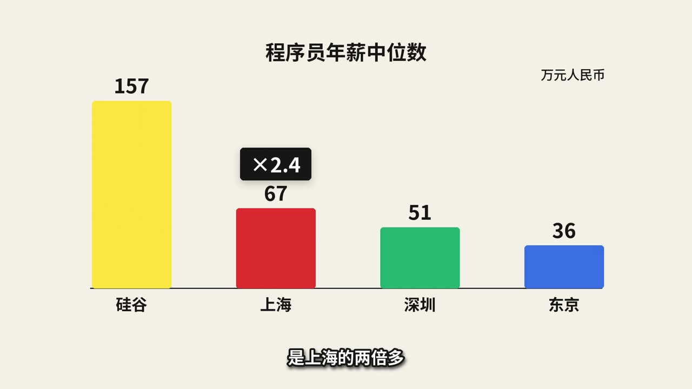
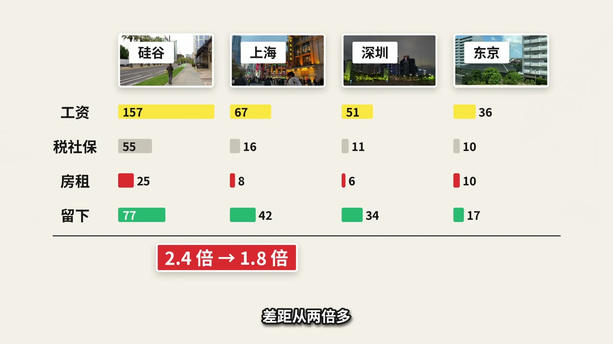

# explainer-video-playbook

把「逐句分镜 + 分段配音 + 素材」变成画面跟着词走的中文科普短片：默认纯 ffmpeg，也能交给剪辑软件继续编辑。

| 实拍关键词 | 数据讲解板 |
|---|---|
|  |  |
|  |  |

截图来自本仓库案例《选城市的三本账》的成品（[在 YouTube 观看](https://youtu.be/on2x-uefxvc)），用于展示排版；仓库里不包含完整视频或原始素材。

## 快速开始

需要 Python 3.10+、ffmpeg/ffprobe（含 libx264）。macOS 可用 `brew install python ffmpeg`；其他系统安装对应软件包即可。无需安装任何剪辑软件。

```bash
python3 -m venv .venv
. .venv/bin/activate
pip install -r requirements.txt
bash tools/fetch_fonts.sh
bash tools/fetch_footage.sh examples/city-choice/footage.json build/footage
python tools/prepare_stills.py --spec examples/city-choice/beats.json --footage build/footage --output build/stills
python tools/align.py --spec examples/city-choice/beats.json --edl examples/city-choice/edl.json --output build/timeline.json
python tools/render.py --spec examples/city-choice/beats.json --timeline build/timeline.json --fonts build/fonts --stills build/stills --output build/layers --frames 10,150,600,932,1250,1560,2350,3080,3500,4580
```

此时可查看 `build/layers/gfx/`、`subs/` 的十张样帧和 `subs.srt`。去掉 `--frames` 就渲染全片。素材下载约数 GB，时间取决于网络；字体和素材均不打包在仓库内。

要做自己的片子，或换一套配音，请按 [完整流水线](docs/02-pipeline.md) 重建时间戳、段落和分镜触发时间。**任何 TTS 或真人录音都可以，每个有旁白的段落一个 WAV**；仓库没有配音音频，示例时间戳只对应原录音，换声音后不能直接套用。

## 目录

| 路径 | 内容 |
|---|---|
| [docs/01-methodology.md](docs/01-methodology.md) | 叙事、视觉与审片方法论 |
| [docs/02-pipeline.md](docs/02-pipeline.md) | 从配音到成片的可复制命令 |
| [docs/03-backends.md](docs/03-backends.md) | ffmpeg、FCPXML、Resolve Studio 与导入限制 |
| [docs/04-beats-schema.md](docs/04-beats-schema.md) | 规格、绘图元素与表达式接口 |
| [docs/05-visual-style.md](docs/05-visual-style.md) | 色板、十二种元素样张、字幕规格、封面模板 |
| [templates/cover/](templates/cover/) | 16:9、4:3、3:4 封面 HTML 模板 |
| `tools/` | 对齐、渲染、EDL、混音、合成、审片和导出 |
| `examples/city-choice/` | 分镜 JSON / 原稿、净化时间戳、EDL、Pexels 清单、带来源的研究及复算脚本 |
| `tests/` | 像素等价性、XML 结构检查、生成素材集成测试与验收记录 |
| `build/` | 本机生成或下载的文件，git 忽略 |

素材 ID、数字、城市名和案例布局只出现在示例中；工具保留通用的 1080p / 25 fps 风格预设。图形与字幕各是一层透明 RGBA；动画按绝对帧计算，支持任意跳帧。

## 验证

```bash
python -m unittest discover -s tests -v
python tests/check_fcpxml.py build/timeline.fcpxml examples/city-choice/v1_edl.json
# 本机若保留原制作项目，可重跑像素对比：
python tests/check_equivalence.py --original "$ORIGINAL_PROJECT" --work /tmp/playbook-check --fonts build/fonts
```

单元测试需要先下载字体；媒体集成测试自行生成测试音视频，不下载素材。XML 检查只证明结构、帧长和引用正确，编辑器实机导入仍须检查。验收结果见 [tests/acceptance.json](tests/acceptance.json)。

## 致谢与许可

感谢 [Pexels](https://www.pexels.com/license/) 的实拍素材、[Mixkit](https://mixkit.co/license/) 的音乐资源，以及 [得意黑 Smiley Sans](https://github.com/atelier-anchor/smiley-sans)、[霞鹜文楷 LXGW WenKai](https://github.com/lxgw/LxgwWenKai) 与 [Noto Sans SC](https://fonts.google.com/noto) 字体。默认画面用得意黑、字幕用霞鹜文楷 Medium，缺字回退到 Noto Sans SC。`tools/fonts.json` 的 `active` 或环境变量 `PLAYBOOK_FONT_PRESET=noto` 可切回原来的全 Noto 粗体。下载前核对各项资产的许可；本仓库只给素材 ID、页面与直链，音乐请自行选择并保存许可记录。

代码（`tools/`、`tests/` 和案例的计算脚本）采用 [MIT](LICENSE)；文档、分镜规格、配音文稿和研究整理采用 [CC BY 4.0](LICENSE-DOCS.txt)，署名 `explainer-video-playbook contributors`，转载注明仓库名、来源链接及修改情况。第三方数据、字体、音乐、实拍及截图中的实拍部分保持原许可，不因本仓库的许可而变更。上述字体均为 SIL OFL 1.1，下载脚本同时获取许可证。请勿把下载的原始素材、配音、字体或制作日志提交到仓库。
