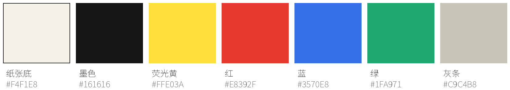
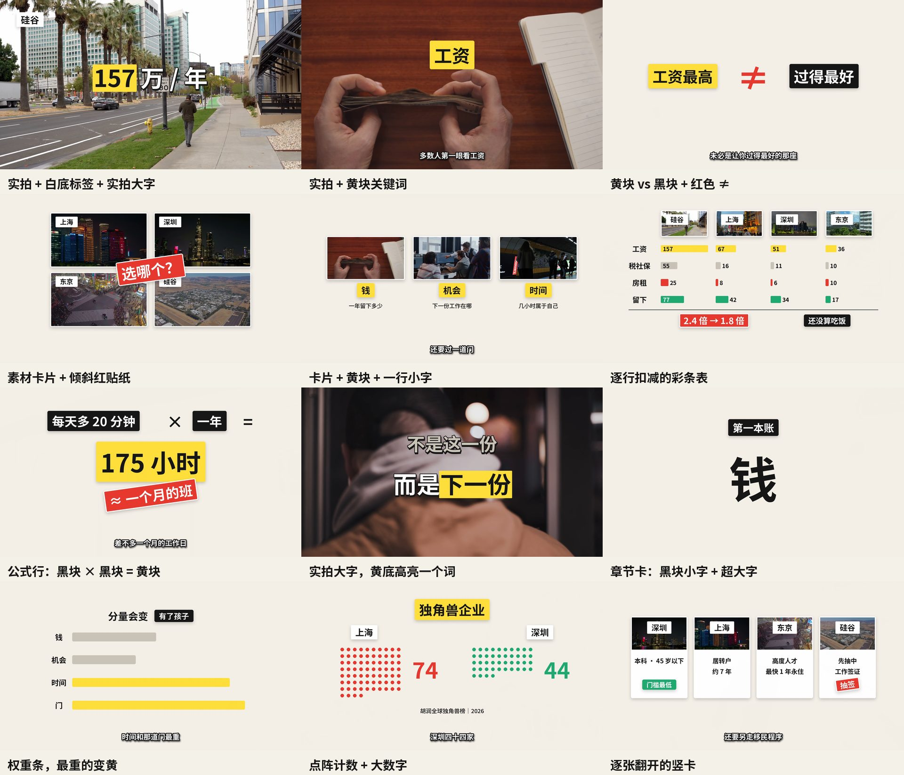
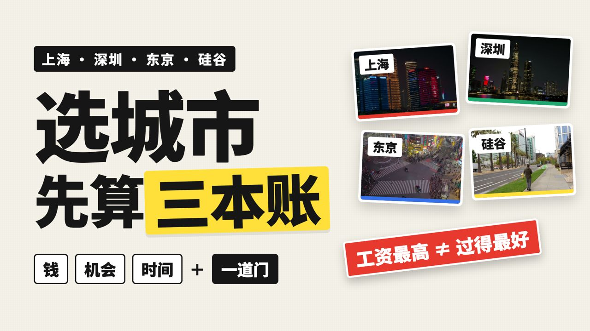
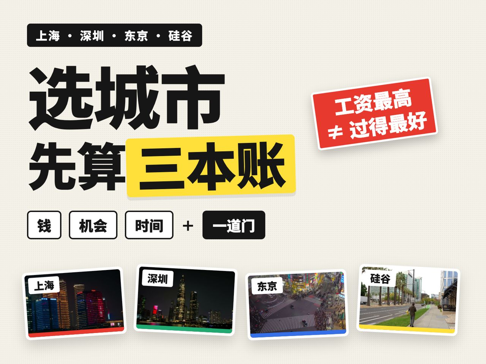
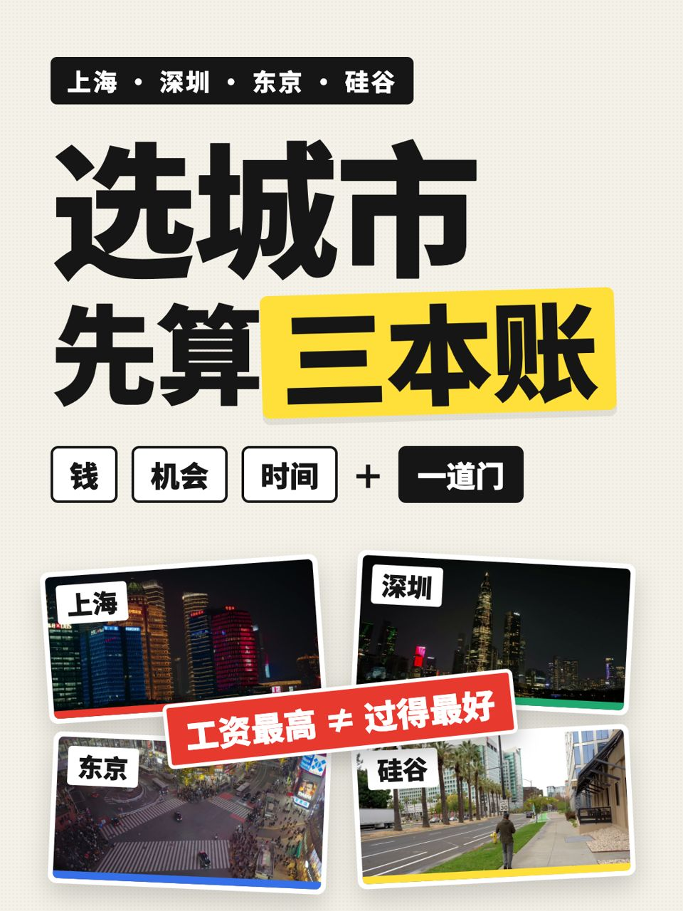

# 视觉风格参考

这一页是照着做时对照用的：每种元素长什么样、颜色怎么用、封面怎么排。所有图都截自用本仓库流程做出的成片《选城市的三本账》。规则和原因见 [01-methodology.md](01-methodology.md)。

## 色板



- 纸张底和墨色占画面的绝大部分。
- 荧光黄每屏最多出现一处，只给这一句里最重要的词或数字。
- 红色用于反转和提醒；蓝、绿用于对比项。
- 对比多个对象时，每个对象固定一个颜色，全片不变。这个例子里是上海红、深圳绿、东京蓝、硅谷黄。

## 元素样张



| 样张 | 要点 |
|---|---|
| 实拍 + 白底标签 + 实拍大字 | 标签只放在左上角，写地点或对象；大字放在画面中上部，避开字幕区 |
| 实拍 + 黄块关键词 | 旁白读到这个词的那一帧弹出；一个镜头里只放一个 |
| 黄块、黑块对照 + 红色 ≠ | 讲「A 不等于 B」时用；两块先后出现，≠ 最后弹出 |
| 素材卡片 + 倾斜红贴纸 | 卡片就是实拍静帧，和实拍画面视觉上连着；红贴纸倾斜 6–10° |
| 卡片 + 黄块 + 一行小字 | 介绍框架时，一个概念一张卡，后出现的不顶掉先出现的 |
| 逐行扣减的彩条表 | 每读到一个扣减项，就多长出一行；最后一行是结论，用最醒目的颜色 |
| 公式行 | 黑块 × 黑块 = 黄块，结果最后弹出并放大 |
| 实拍大字，黄底高亮一个词 | 两行对照：上一行灰、下一行亮 |
| 章节卡 | 黑块小字「第一本账」+ 超大字；约 2.2 秒，没有旁白 |
| 权重条 | 同一组条在不同阶段变长变短，当前最重的变黄 |
| 点阵计数 | 一个点代表一个单位，逐个亮起，旁边大数字同步计数 |
| 逐张翻开的竖卡 | 读到哪个对象，就翻开哪一张；没轮到的保持灰色占位 |

全部元素都画在 1920×1080、25 帧/秒的画布上。讲解板的内容必须整体居中、占满安全区（x 120–1800，y 90–880），底部留给字幕。

## 字幕

见上图每张样张的底部：白字约 48px（霞鹜文楷 Medium），6px 黑描边加投影，基线在 y≈1010，每屏最多 16 个字，不带句末标点，文字一律用原稿。贴纸、标签和实拍大字用得意黑。缺字回退 Noto Sans SC。字体文件由 `tools/fetch_fonts.sh` 从官方发布页下载，角色映射在 [`tools/fonts.json`](../tools/fonts.json)；`PLAYBOOK_FONT_PRESET=noto` 可切回原来的 Noto Sans SC Bold。对照见 [字体前后对比](img/style/font-comparison.jpg)。

HarmonyOS Sans、MiSans、阿里巴巴普惠体都可以商用出片，但官方协议限制转载或再分发字体文件，所以没有放进下载脚本。

## 封面

| 16:9（B站、YouTube） | 4:3 | 3:4（小红书、抖音） |
|---|---|---|
|  |  |  |

封面沿用视频里的元素：

- 一行黑块写对象，例如「上海 · 深圳 · 东京 · 硅谷」。
- 超大黑字标题，最关键的几个字压在荧光黄块上。
- 框架拆成几个白底描边的小块。
- 四张略微倾斜的素材卡片，底边是各自的对象色。
- 一张红贴纸写反直觉的结论。

模板在 [`templates/cover/`](../templates/cover/)：把四张静帧放到 `templates/cover/images/1.jpg`…`4.jpg`，再运行 `tools/fetch_fonts.sh` 下载字体（封面标题用得意黑，并回退 Noto Sans SC），然后用浏览器截图即可。

```bash
"/Applications/Google Chrome.app/Contents/MacOS/Google Chrome" --headless=new --hide-scrollbars --window-size=1920,1080 --allow-file-access-from-files --screenshot="$PWD/cover_16x9.png" "file://$PWD/templates/cover/cover_16x9.html"
```

4:3 用 `--window-size=1440,1080`，3:4 用 `--window-size=1080,1440`。Linux 上把 Chrome 路径换成 `google-chrome` 或 `chromium`。

## 风格从哪来

这套语汇是拆解一支参考样片后整理出来的，拆的是版式语汇，不是具体画面。做新题材时，建议也先找一支自己喜欢的样片，抽帧拼成一张图，逐条对照：用了哪几种元素、多久变一次画面、字放在哪里。然后再改色板和元素，不要直接照搬别人的画面。
